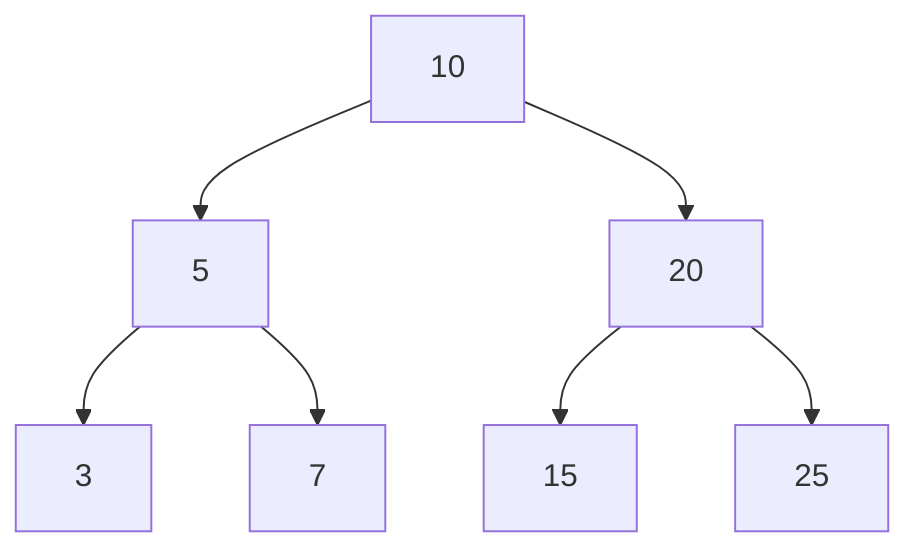

# Binary Trees

So Ideally we have to be aware of recursion and traversels 

Here are the main types of binary tree search and traversal implemented using recursion in Python. These examples use the same `TreeNode` structure so you can paste them into a visualizer and observe how recursive calls accumulate and unwind.

## 1. Common tree-search and traversal methods

Consider this binary tree for all the examples:



1\. Preorder traversal (Root → Left → Right)

Visits the root before exploring its subtrees.

Output: `10, 5, 3, 7, 20, 15, 25`

2\. Inorder traversal (Left → Root → Right)

Explores the left subtree before visiting the root.

Output: `3, 5, 7, 10, 15, 20, 25`

3\. Postorder traversal (Left → Right → Root)

Visits the root only after both subtrees.

Output: `3, 7, 5, 15, 25, 20, 10`

4\. Recursive DFS search

Searches for a target value and stops when found.

Example: Search for `15`.

## 2. Python implementations

### Define the tree node

```
class TreeNode:    def __init__(self, val, left=None, right=None):        self.val = val        self.left = left        self.right = rightroot = TreeNode(    10,    TreeNode(5, TreeNode(3), TreeNode(7)),    TreeNode(20, TreeNode(15), TreeNode(25)))
```

### A. Preorder traversal

```
def preorder(root):    if root is None:        return    print(root.val, end=" ")    preorder(root.left)    preorder(root.right)preorder(root)# Output: 10 5 3 7 20 15 25
```

How it works: Visit the current node first, recursively traverse the left subtree, and then traverse the right subtree.

### B. Inorder traversal

```
def inorder(root):    if root is None:        return    inorder(root.left)    print(root.val, end=" ")    inorder(root.right)inorder(root)# Output: 3 5 7 10 15 20 25
```

How it works: Recursively traverse the left subtree, visit the current node, and then traverse the right subtree. For a binary search tree (BST), inorder traversal produces values in sorted order.

### C. Postorder traversal

```
def postorder(root):    if root is None:        return    postorder(root.left)    postorder(root.right)    print(root.val, end=" ")postorder(root)# Output: 3 7 5 15 25 20 10
```

How it works: Recursively process both subtrees before visiting the current node. This order is useful when deleting a tree or processing children before parents.

### D. Depth-first search (DFS) for a target

```
def dfs_search(root, target):    if root is None:        return False    if root.val == target:        return True    return (        dfs_search(root.left, target)        or dfs_search(root.right, target)    )print(dfs_search(root, 15))  # Trueprint(dfs_search(root, 99))  # False
```

How it works: Check whether the current node matches the target. If it does, return `True`. Otherwise, search the left subtree first. If the target is not found there, search the right subtree. Return `False` if both searches fail.

Python's `or` operator short-circuits, so the right subtree is not searched if the left subtree already finds the target.

## 3. Complexity comparison

Let \\(n\\) be the number of nodes and \\(h\\) the height of the tree.

| Method     | Time complexity       | Auxiliary space |
| ---------- | --------------------- | --------------- |
| Preorder   | \\(O(n)\\)            | \\(O(h)\\)      |
| Inorder    | \\(O(n)\\)            | \\(O(h)\\)      |
| Postorder  | \\(O(n)\\)            | \\(O(h)\\)      |
| DFS search | \\(O(n)\\) worst case | \\(O(h)\\)      |

The traversals visit every node, whereas DFS search can stop early if the target is found.

## 4. What to try in your visualizer

Run `dfs_search(root, 15)` and step through the execution.

1. Watch the call stack grow as the search explores the left subtree.
2. Observe calls returning `False` when they encounter `None`.
3. Watch the search backtrack and explore other branches.
4. When node `15` is reached, the function returns `True`, and short-circuiting prevents unnecessary searches.

Important distinction: Preorder, inorder, and postorder are traversal orders. DFS is a search strategy that explores one branch deeply before backtracking; it can use different child-visiting orders. For a general binary tree, all nodes may need to be examined. For a BST, you can do better by comparing the target with each node and choosing only the relevant subtree.